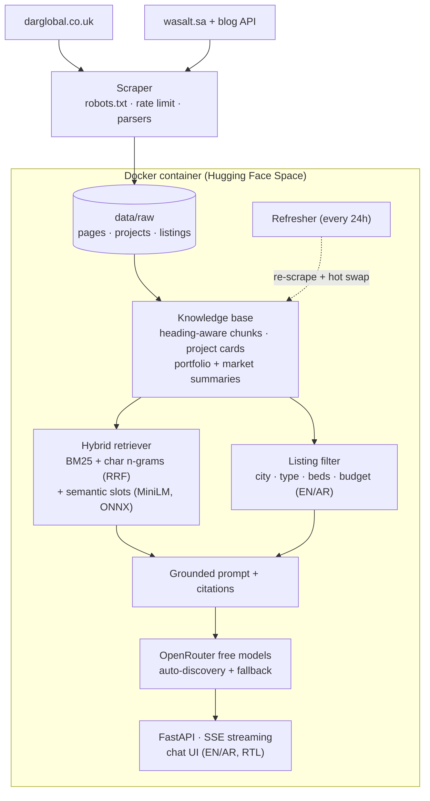

# DarGlobal × Wasalt Property Assistant

A retrieval-augmented chatbot that answers questions about **DarGlobal** developments and
**Wasalt** property listings, using data scraped from their public websites and a **free
OpenRouter model**. Packaged with Docker and deployed on Hugging Face Spaces.

**Live demo:** `https://<your-hf-username>-<space-name>.hf.space`  ·  **API docs:** `/docs`

---

## What it does

| | |
|---|---|
| **Scrapes** | darglobal.co.uk (project pages, press, blog, partner pages) and wasalt.sa (property listings, company pages, WordPress blog). The scraper respects robots.txt, rate-limits itself, retries, and stops calling a site that blocks it. |
| **Understands** | Free-text questions in **English and Arabic**, including follow-ups ("what about the cheapest ones?"), typos ("trump towr jedah") and listing requests like *"3-bed villa in Riyadh under 2M"*. |
| **Retrieves** | Hybrid search: **BM25 + character n-gram TF-IDF** (merged with reciprocal rank fusion) for names, typos and transliterations, plus **multilingual semantic embeddings** for paraphrases ("where is it located?" → "headquartered in London") and a **structured listing filter**, so prices and specs come from the data, not from the model. |
| **Answers** | Streams a grounded answer from a free OpenRouter model, with clickable citations `[1]` and listing cards `[L1]`. |
| **Stays up** | Discovers the current free models at startup and falls back between them automatically. Caches repeat answers and rate-limits each visitor. If no model is reachable, it still returns the relevant sources and listings. |
| **Stays fresh** | Re-scrapes inside the container on a schedule (default every 24 h), checks the result, and swaps in the new index without downtime. If a refresh fails, the last good data keeps serving. |

## Architecture



### Design decisions

- **Lexical first, semantic for paraphrases.** BM25 + character n-grams handle exact names (projects, districts, brands), typos and transliterations (Yasmeen/Yasmin); an Arabic→English glossary lets Arabic questions match English text. Lexical search can't bridge different wording, though: "where is DarGlobal located?" missed the FAQ that says "headquartered in London". So a small multilingual embedding model (`paraphrase-multilingual-MiniLM-L12-v2`, ONNX via fastembed, no PyTorch, baked into the image) adds semantic matches.
  - **Reserved slots, not one fused ranking.** Measured on `scripts/eval.py`: fusing the dense list into RRF at any weight lowered hit@1 from 0.89 to 0.72 on name questions. Instead, lexical keeps the top 4 positions and the best semantic matches fill the last 2 of the 6 chunks the LLM reads. Result: hit@1 unchanged (0.89), answer-in-context (ctx@6) 0.89 → **1.00**, including the Arabic paraphrase.
  - **Brand spellings are normalised for the model** ("dar global", "دار جلوبال" → "DarGlobal"): measured, the FAQ ranked #22 / #346 before and #1 after.
  - **Precomputed and cached.** Vectors are stored per chunk-text hash in `data/raw/embeddings.npz` (int8, 6 MB), so the Space starts in seconds and a refresh embeds only new chunks. Without the model, retrieval falls back to lexical-only.
- **Structured data for structured questions.** Listing questions go through deterministic filters over the scraped listings. The model can then only quote a price that exists in the data. When nothing matches exactly, the filters are relaxed step by step and the answer says so.
- **Precomputed summaries for "aggregate" questions.** Plain RAG struggles with questions like "which projects are in Oman?" or "median villa price in Riyadh?", because the answer is spread over many pages. A portfolio overview (projects grouped by country) and a market snapshot (median, range, price per sqm by city and type) are generated at build time and retrieved for these questions.
- **Free-tier engineering.** OpenRouter's free models rotate, and the free tier allows few requests per day. The app ranks the current free models, sends 3 at a time in OpenRouter's `models` fallback array, and ends with the `openrouter/free` router. It makes one LLM call per message, caches answers for an hour, and rate-limits each IP.
- **Safety and privacy.** Retrieved text is marked as data in the prompt, so instructions inside a scraped page are ignored. Listing pages are stored only as structured records. Broker names and phone numbers are not kept.

## Run it locally

```bash
pip install -r requirements-dev.txt
cp .env.example .env              # add your OPENROUTER_API_KEY (free at openrouter.ai/keys)

python -m scraper.run             # ~10-20 min; writes data/raw/ (pages.jsonl, projects.json, listings.json)
uvicorn app.main:app --port 7860 --env-file .env  # open http://localhost:7860
```

With Docker:

```bash
docker build -t dar-assistant .
docker run --rm -p 7860:7860 --env-file .env dar-assistant
```

If `data/raw/` is empty, the app falls back to a small bundled seed snapshot in `data/seed/` so it always starts.

### Scraper options

```bash
python -m scraper.run --sites darglobal            # one site only (other sites' data is kept)
python -m scraper.run --max-listings 800 --delay 1  # more listings, slower crawl
python -m scraper.run --render                     # Playwright fallback for JS-only pages
```

## Deploy (Hugging Face Spaces, free)

1. Create a new **Space** → SDK **Docker** → Blank → hardware **CPU basic (free)** → Public.
2. In **Settings → Variables and secrets** add:
   - secret `OPENROUTER_API_KEY`
   - secret `ADMIN_TOKEN` (optional, enables `POST /api/admin/refresh`)
   - variable `APP_URL` = `https://<user>-<space>.hf.space`
3. Push this repository (including `data/raw/`) to the Space (username + a *write* access token as password):
   ```bash
   git remote add space https://huggingface.co/spaces/<user>/<space>
   git push --force space main      # replaces the Space's placeholder README
   ```
4. The image builds in a few minutes. The app is then served at `https://<user>-<space>.hf.space`.

## API

| Method | Path | Purpose |
|---|---|---|
| `POST` | `/api/chat` | Chat as a Server-Sent Events stream (`meta` → `delta`… → `done`) |
| `POST` | `/api/chat/sync` | Same, as one JSON response (`answer`, `sources`, `listings`, `model`) |
| `GET` | `/api/health` | Dataset stats, model candidates, refresh status |
| `GET` | `/api/search?q=` | Inspect retrieval results (explainability) |
| `GET` | `/api/listings/search?q=` | Natural-language → structured listing search |
| `GET` | `/api/projects` | Structured DarGlobal project records |
| `POST` | `/api/admin/refresh` | Trigger a re-scrape (header `X-Admin-Token`) |

```bash
curl -s -X POST https://<space-url>/api/chat/sync -H 'Content-Type: application/json' \
     -d '{"message":"Show me villas for sale in Riyadh under 2 million SAR"}'
```

## Configuration

| Variable | Default | |
|---|---|---|
| `OPENROUTER_API_KEY` | – | required for generated answers (otherwise retrieval-only mode) |
| `OPENROUTER_MODELS` | auto | comma-separated model IDs to pin instead of auto-discovery |
| `REFRESH_INTERVAL_H` | `24` | background re-scrape interval; `0` disables |
| `ADMIN_TOKEN` | – | enables the manual refresh endpoint |
| `TOP_K` / `MAX_LISTINGS` | `6` / `6` | context size |
| `RATE_LIMIT_PER_MIN` | `12` | per-IP message limit |
| `CACHE_TTL_S` | `3600` | answer cache lifetime |

## Quality checks

```bash
pytest -q                 # 63 tests: parsers (incl. live-page layouts), crawler (local test site,
                          # bot-challenge handling), retrieval (lexical + semantic slots), query parser,
                          # LLM fallback logic, chat pipeline, cache, rate limit, refresher
python scripts/eval.py    # retrieval hit@k / MRR on a labelled EN/AR question set
python scripts/eval.py --live https://<space-url>   # end-to-end answers from the deployment
```

CI (GitHub Actions) runs the tests, builds the image and smoke-tests the container.

## Project layout

```
app/        FastAPI app: knowledge base, retrieval, listing filter, prompts, OpenRouter client, refresher, UI
scraper/    polite crawler, generic HTML extraction, DarGlobal + Wasalt parsers, CLI
data/raw    scraped snapshot shipped in the image      data/seed   small fallback snapshot
tests/      unit + integration tests                   scripts/    evaluation
```

## Limitations and next steps

- Listing prices reflect the time of the scrape. Answers say so, and the scheduled refresh keeps the data reasonably current.
- Possible next steps:
  - a larger embedding model (the current one reads ~128 tokens per chunk) or a cross-encoder re-ranker;
  - scrape the Arabic versions of both sites;
  - persist refreshed data to a Hugging Face Dataset so it survives restarts;
  - add an LLM-based query rewriter once a paid tier is available.

Data comes from publicly available pages and is used for this technical assessment only.
