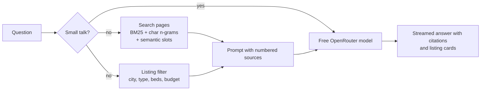

# Haya

A chatbot for questions about DarGlobal projects and Wasalt property listings, in English and
Arabic. It answers from data scraped from darglobal.co.uk and wasalt.sa, uses a free model
through OpenRouter, and runs as a Docker container on Hugging Face Spaces.

**Live:** https://anfashassan-dar-assistant.hf.space  ·  Product overview: [`/overview`](https://anfashassan-dar-assistant.hf.space/overview) ([PDF](docs/Haya-product-overview.pdf))  ·  API docs: [`/docs`](https://anfashassan-dar-assistant.hf.space/docs)


Things to try:

- Which DarGlobal projects are in Oman?
- Compare The Astera and Urban Oasis by Missoni
- Villas for sale in Riyadh under 2 million SAR, then "what about Jeddah?", then "only the newest ones"
- شقق للإيجار في جدة بثلاث غرف
- Does DarGlobal have any jobs open?

## Data

Scraped in November 2026 (`data/raw/`, shipped inside the image):

| Source | Content |
|---|---|
| darglobal.co.uk | 402 pages: 37 projects, partner pages, 68 press releases, 209 blog posts, FAQ, investor and careers pages |
| wasalt.sa | 807 pages (city and category pages, company pages), 3,358 structured listings |
| blog.wasalt.sa | 500 posts via the WordPress REST API |

Notes on the scraper (`scraper/`):

- It respects robots.txt, waits 0.75 to 1 second between requests per host, retries with
  backoff and stops calling a host after 8 failures in a row.
- darglobal.co.uk is behind an Imperva bot check that answers plain HTTP requests with an
  empty challenge page (status 200). The scraper detects these pages and, with `--render`,
  loads them in headless Chromium instead.
- Wasalt listing URLs come from the sitemaps listed in its robots.txt (about 60,000 listings).
  The scraper takes an even sample across the sitemap so the data covers many cities, types
  and price ranges. Wasalt's `llms.txt` allows extraction of public listing content.
- Listing pages are stored only as structured records (type, city, district, price, beds,
  size, year). Broker names and phone numbers are not kept.
- Re-runs merge by URL and ID, so an interrupted or partial run never removes data.

Cleaning:

- Sale or rent comes from the listing URL, not the page text (every Wasalt page header says
  "Properties for Sale").
- City spellings are normalised ("Aldammam" → Dammam, "Alttayif" → Taif).
- 26 listings with impossible prices are dropped at load time, e.g. land "for sale" at
  SAR 1,828 (the per-m² price shown as the total) or a "rental" at SAR 1.9 billion.

## How it answers



- **Pages** are split by heading into about 16,000 chunks. Search combines BM25 (exact names)
  with character n-grams (typos, transliterations such as Yasmeen / Yasmin) using reciprocal
  rank fusion. An Arabic → English glossary lets Arabic questions match English pages.
- **Semantic search** (`paraphrase-multilingual-MiniLM-L12-v2` via fastembed, ONNX, no PyTorch)
  fills the last 2 of the 6 sources the model reads. Fusing it into the main ranking lowered
  hit@1 from 0.89 to 0.72 on name questions, so lexical search keeps the top positions. Vectors
  are precomputed (int8, 6 MB) and the model is part of the image, so the container starts in
  about 8 seconds.
- **Listing questions** go through a structured filter over the listings, so prices in answers
  always come from real records. Results are spread across price range and district. If
  nothing matches, filters are relaxed one at a time and the answer says so.
- **Summaries** are generated for questions that span many pages: projects per country, and
  median / range / price per m² by city and property type.
- **Follow-ups** keep the filters from the last three turns ("what about Jeddah?", "cheaper
  ones?"). Projects named earlier stay in context ("how many bedrooms do the villas have?").
- **Model**: one call per message. Free models are discovered from OpenRouter's catalogue at
  startup and tried in order, ending with the `openrouter/free` router. If no model responds,
  the app still returns the matching sources and listings. Answers are cached for an hour.
- **Grounding**: facts about DarGlobal and Wasalt must come from the sources and are cited.
  General questions get a short general answer. Text from scraped pages is treated as data,
  not instructions.
- **Voice input** uses the browser's speech recognition (English or Arabic, following the UI
  language). The text lands in the input box for editing; nothing is sent automatically. Chrome
  sends the audio to Google's speech service, Safari to Apple's; the button is hidden where the
  browser has no support (Firefox).
- **Figure check** (`app/verify.py`): after each answer, every SAR amount and year is matched
  against the sources the model was given (rounding allowed, Arabic digits included). The UI
  shows "6 figures checked against sources", or a warning listing any figure it can't find.

## Testing

```bash
pytest -q                          # 92 tests
python scripts/eval.py             # retrieval: is a page that answers the question retrieved?
python scripts/eval_answers.py     # answers: graded by an LLM judge against known facts
```

Unit tests cover the parsers (with fixtures from real pages), the crawler against a local
test site (robots.txt, sitemaps, bot challenges), retrieval, the listing query parser,
model fallback, the chat pipeline and the background refresh. They run without network
access or an API key.

`scripts/eval.py` checks whether a page that answers each question is retrieved:

| | hit@1 | hit@3 | answer in the 6 sources the model reads |
|---|---|---|---|
| Current | 0.95 | 1.00 | 1.00 |

The question set is small (21), so treat it as a regression check, not a benchmark.
Paraphrases like "where is DarGlobal located?" (the page says "headquartered in London") were
the reason for adding semantic search; they are now also covered by intent keywords, so with
or without embeddings the score on this set is the same.

`scripts/eval_answers.py` checks the answers themselves. Each of 21 questions has facts taken
from the scraped data (some computed, like the cheapest land in Dammam) and, for trap
questions, claims the answer must not make (a project in Paris, a made-up share price, a
leaked system prompt). A model from a different family than the one answering (Gemma vs.
Nemotron) grades each answer. Latest run: **21/21 pass**, median answer time 5.5 s, one
figure flagged by the figure check. Full report: [docs/answer-eval.md](docs/answer-eval.md).

The first run of this eval scored 17/21 and found two real problems: model discovery could
fail at startup and leave only a router that sometimes returns empty answers (now falls back
to known models and retries after a minute), and a project in older articles whose page has
since been removed from DarGlobal's site.

I also ran 84 questions in three rounds against the running app and read every answer:
general knowledge, small talk, DarGlobal facts, listing searches, Arabic, typos, multi-turn
conversations and prompt-injection attempts. Problems found this way (a currency word matched
as a district name, a project missing from comparisons, follow-ups losing their filters,
implausible prices) each have a test now.

## Run it

```bash
pip install -r requirements-dev.txt
cp .env.example .env                                 # set OPENROUTER_API_KEY
uvicorn app.main:app --port 7860 --env-file .env     # http://localhost:7860
```

Docker:

```bash
docker build -t dar-assistant .
docker run --rm -p 7860:7860 --env-file .env dar-assistant
```

Without an API key the app runs in retrieval-only mode. Without `data/raw/` it falls back to
the small snapshot in `data/seed/`.

Re-scrape:

```bash
python -m scraper.run --render                           # all sites, 1 to 2 hours
python -m scraper.run --sites wasalt blog --max-listings 3000
```

`--render` needs `pip install playwright && playwright install chromium`. The container
re-scrapes Wasalt every 24 hours. It has no browser, so DarGlobal keeps the shipped data.

## Deploy to Hugging Face Spaces

1. Create a Space with the Docker SDK (blank template).
2. Add the secret `OPENROUTER_API_KEY` and the variable `APP_URL` (the Space URL).
3. Push this repository to the Space. `*.npz` and `*.png` are stored with Git LFS.

## API

| Method | Path | |
|---|---|---|
| POST | `/api/chat` | Chat, streamed as server-sent events |
| POST | `/api/chat/sync` | Same, as one JSON response |
| GET | `/api/health` | Data counts, model candidates, refresh status |
| GET | `/api/search?q=` | Retrieval results for a query |
| GET | `/api/listings/search?q=` | Natural-language listing search |
| GET | `/api/projects` | DarGlobal project records |
| POST | `/api/admin/refresh` | Start a re-scrape (needs `ADMIN_TOKEN`) |

```bash
curl -s -X POST https://anfashassan-dar-assistant.hf.space/api/chat/sync \
     -H 'Content-Type: application/json' -d '{"message":"Villas in Riyadh under 2M"}'
```

## Configuration

| Variable | Default | |
|---|---|---|
| `OPENROUTER_API_KEY` | | required for generated answers |
| `OPENROUTER_MODELS` | auto | comma-separated model IDs instead of auto-discovery |
| `EMBEDDINGS` | `1` | `0` turns semantic search off |
| `REFRESH_INTERVAL_H` | `24` | background re-scrape interval, `0` to disable |
| `ADMIN_TOKEN` | | enables `/api/admin/refresh` |
| `TOP_K` / `MAX_LISTINGS` | `6` / `6` | sources and listings per answer |
| `MAX_TOKENS` | `1500` | answer length limit |
| `RATE_LIMIT_PER_MIN` | `12` | messages per minute per IP |
| `CACHE_TTL_S` | `3600` | answer cache lifetime |

## Project layout

```
app/        FastAPI app: knowledge base, retrieval, embeddings, listing search, prompts,
            OpenRouter client, chat pipeline, refresh job, static UI
scraper/    crawler, HTML extraction, DarGlobal and Wasalt parsers
data/raw    scraped snapshot (shipped in the image)
data/seed   small fallback snapshot
tests/      unit and integration tests
scripts/    eval.py (retrieval), eval_answers.py (answers)
docs/       screenshot, answer-eval.md
```

## Limitations

- Listing prices are from the scrape date. The 24-hour refresh updates Wasalt only.
- Free models take 3 to 15 seconds per answer and are rate-limited by OpenRouter.
- The embedding model reads only the first ~128 tokens of each chunk.
- Only the English versions of both sites were scraped.

Data comes from public pages and is used for this assessment only.
